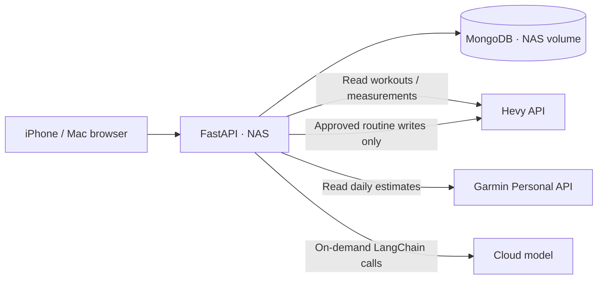
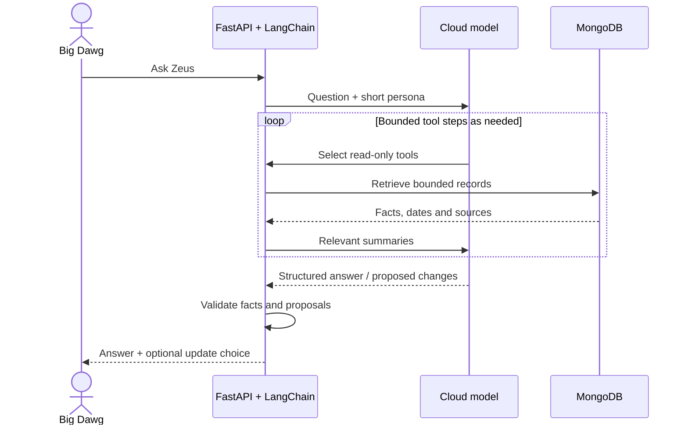

# 💪 AMORE GYM BRO

**Legend:** 🟢 Confirmed Hevy records · 🟣 Your reports · ⌚ Garmin estimates · ⚡ On-demand AI · ✅ Human-approved changes

Training receipts, watch readings and goals—with **Proffessor Zeus**, your science-aware gym bro. ⚡

**Jump to:** [Use it](#use-it) · [Install](#install) · [Architecture](#architecture) · [AI, LangChain & RAG](#ai-langchain-and-rag) · [Database](#database) · [Hevy](#hevy) · [Garmin](#garmin) · [Development](#development)

## Use it

📱 Open [the NAS app](http://192.168.2.49:8787) on home Wi-Fi. iPhone Safari: **Share → Add to Home Screen**.

- **Home:** today’s proposed session, weight/goal, watch summaries and completed training.
- **History:** confirmed workouts, records and totals.
- **Goals & profile:** reported details and estimated daily macros.
- **Check-ins:** how you feel; **Zeus:** questions and adjustments.
- **Weekly plan:** proposed sets, reps and trial loads—not completed lifts.

No Mac, SSH or vault unlock needed. Private authenticated gym/cellular access remains unconfigured.

## Install

🛠️ **Fresh, isolated development copy:** Python **3.12**, `uv`, Docker Compose and 1Password CLI with desktop integration. Leave the NAS deployment untouched.

```bash
uv sync --locked
# Preserve existing settings:
test -f .env || cp .env.example .env
```

1. In `.env`, use `MONGODB_DATABASE=amoregymbro_dev`, `BIND_HOST=127.0.0.1` and a free `APP_PORT`, e.g. `8788`. Set `SYNC_ENABLED`, `GARMIN_SYNC_ENABLED` and `WEBHOOK_WORKER_ENABLED` to `false`.
2. Keep ordinary settings in `.env`, **secret fields blank**. Store fresh secrets in 1Password; put copied `op://` references for `APP_PASSWORD`, `APP_SECRET`, `MONGODB_PASSWORD` and `MONGO_INITDB_ROOT_PASSWORD` in ignored `.env.references`. Use distinct database-user/admin passwords; app password ≥10 characters, cookie secret ≥16. Provider keys are optional.
3. Unlock 1Password locally, then start an isolated Compose project:

```bash
op run --env-file .env.references -- \
  docker compose -p amoregymbro-dev up -d --build
```

Open `http://127.0.0.1:8788` for that port. Separate named volumes; no MongoDB host port. Keep background sync disabled; NAS owns scheduled sync.

**Existing NAS:** use [the runbook](docs/nas-mongodb.md) for operations/backups. Preserve its credentials/volumes; don’t repeat migration.

## Architecture

🧱 One FastAPI app and MongoDB on the NAS; cloud inference on demand.



A private Docker network connects app/database. Keep administration, SMB, Docker and MongoDB private.

## AI, LangChain and RAG

### ⚡ How Zeus answers

LangChain’s `create_agent` uses bounded **read-only tools** for profile/macros, workouts, exercise history/options, plans and relevant Garmin summaries. `ToolStrategy(CoachReply)` structures replies; code validates numbers, claims and proposals. The shared persona supplies brief gym-buddy humor, dropping jokes for injury/distress. Zeus cannot observe form or diagnose injuries.



**RAG = Retrieval-Augmented Generation:** retrieve relevant records, then answer from that context. Here it means structured database lookups without embeddings/vector storage. Saved chats are display history, not retrieved conversation memory.

### 🔬 Research and routine changes

The outline requires goal, Hevy weight, height, age, sex, activity, days/week, minutes/session and gym/home before research or inference. Selected PubMed evidence uses public IDs only: at most two excerpts, 800 characters each, with links, checked dates and population limits. Invalid/unavailable evidence blocks inference. This is bounded research, not comprehensive search.

A new outline takes **one model call**; it doesn’t rebuild the detailed plan. Chat can propose up to three focused changes: **Update my plan / Keep current plan**. Acceptance creates a local version; Hevy requires separate review/approval. Zeus has no write tool. ✅

### 💸 How requests stay cheaper

- Small context slices; Garmin defaults to three days, maximum seven, filtered by metric group.
- Python calculates metrics/macros. Model responses cap at **700 tokens**; chat has an **eight-step** agent limit and may make multiple paid calls.
- **24-hour public research cache**; reuse the latest valid outline when inputs/evidence/model/persona match. Chat answers aren’t cached.
- No separate personality, extraction, formatting, approval or sync inference.

Summaries/notes reach the cloud; credentials/raw sensor streams don’t. API usage has separate billing. Zeus spots your wallet. 🏋️

## Database

💾 **MongoDB is primary:** Hevy records, reports, plans, chats, Garmin summaries and sync state. Plan versions and permanent decision/publication audits survive chat retention.

Weights store in kg, display in profile units; missing isn’t zero. Macros use a fixed **170 lb** reference target and reported inputs, not logged intake.

NAS-local volumes aren’t backups. SQLite/old Mac data are rollback snapshots, not replicas. Never store database files on SMB or delete volumes to repair connections. [Recovery](docs/nas-mongodb.md)

## Hevy

🟢 Keep logging there. Read-only sync handles pagination, updates, deletions and deduplication; unfinished sets aren’t visible. **Hevy library & sync → View Hevy routines** lists all folders’ templates separately from completed workouts.

Operator-approved publication retains IDs; reviewed updates reuse them. No automatic write retries or Monday clones. [API](https://api.hevyapp.com/docs/)

## Garmin

⌚ The NAS checks seven days about every six hours. **View Garmin details** shows steps, resting HR, HRV/stress/Body Battery, sleep/stages/naps, respiration and blood oxygen. **Sync Garmin now** refreshes readings.

Dated estimates stay separate from lifts; missing displays as dashes. The documented Personal API doesn’t expose Training Readiness/Recovery Time; activity imports aren’t implemented. [Setup, fields and limits](docs/garmin.md)

## Development

🧭 [AGENTS.md](AGENTS.md) maps modules, approvals and phone UI.

```bash
uv run pytest
# Optional isolated MongoDB checks; requires local 1Password approval:
./scripts/test-mongodb.sh
```

`./start-local.sh` uses `.env.app.references`, disables background sync and may restore the SSH tunnel. It can access production data: use the isolated Compose setup above for experiments. Keep secrets out of Git, logs and chat.
